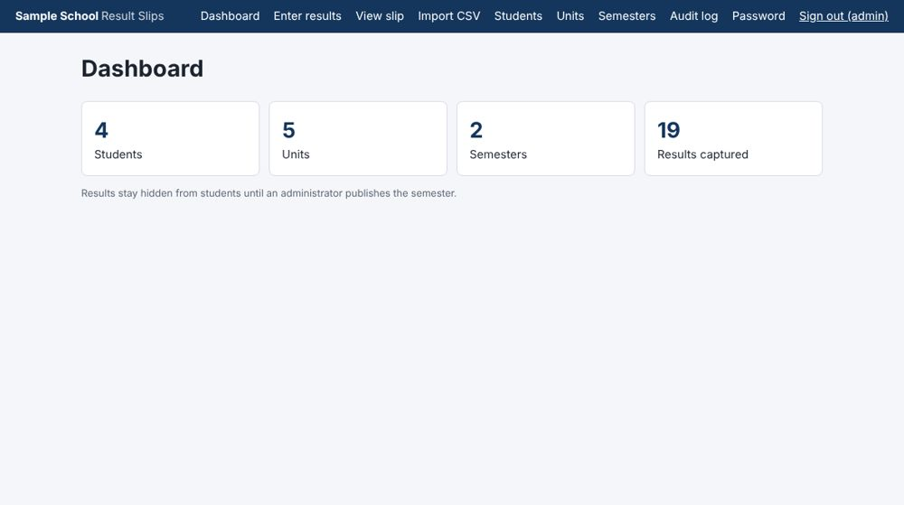
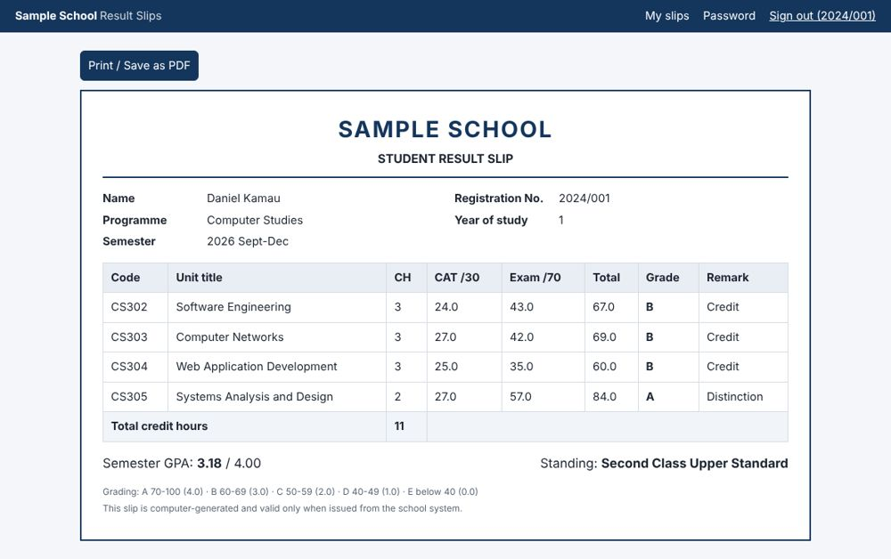
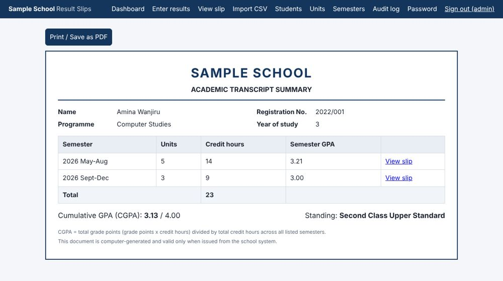
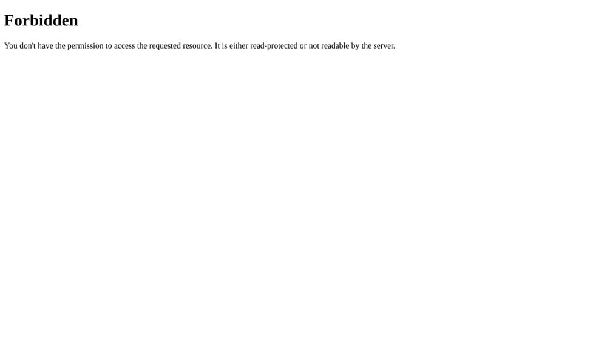

# Student Result Slip System

A role-based school management web app focused on results. Lecturers capture marks (or import them from CSV), the system computes grades, GPA and cumulative GPA automatically, and students view and print only their own slips once an admin publishes the results.

> Demo project. The login accounts below are demo data only.

## Features
- **Three roles:** Admin, Lecturer, Student, each with its own access
- **Marks entry** (CAT /30, Exam /70) with server-side validation, plus **CSV bulk import** (all-or-nothing, with line-by-line error messages)
- **Automatic results:** total, letter grade, grade points, semester GPA, **cumulative GPA (CGPA)** and academic standing
- **Printable result slips and transcripts** (browser print / Save as PDF); unpublished semesters show a DRAFT mark
- **Publish control:** students see results only after an admin publishes the semester
- **Audit log:** every mark change, import, publish, student add/delete and password reset is recorded with who and when
- **Admin password reset** for students
- **Security:** salted password hashes, CSRF protection, role and ownership checks, parameterised SQL, upload size limits

## Screenshots
| Admin dashboard | Published result slip |
|---|---|
|  |  |

| Transcript with CGPA | Access control: another student's slip is blocked (403) |
|---|---|
|  |  |

More screens (CSV import, audit log, marks entry, student management) are in [docs/screenshots](docs/screenshots).

## Quick start
```bash
python3 -m venv .venv
source .venv/bin/activate        # Windows: .venv\Scripts\activate
pip install -r requirements.txt
python seed.py                   # creates results.db with demo data
python app.py                    # open http://127.0.0.1:5000
python test_app.py               # run the automated tests
```

Optional environment variables: `SECRET_KEY` (so sessions survive restarts) and `SCHOOL_NAME` (shown on pages and slips; default "Sample School"), for example `SCHOOL_NAME="Greenfield Academy" python app.py`.

**Demo logins:** `admin` / `admin123`, `lecturer` / `lecturer123`, student `2022/001` / `2022/001` (username is the registration number in lowercase; the initial password is the registration number).

## CSV import format
```csv
reg_no,unit_code,cat,exam
2022/001,CS301,24,52
2022/002,CS301,15,30
```
Pick the semester on the **Import CSV** page. A sample file is in [docs/sample_marks.csv](docs/sample_marks.csv).

## Project structure
```
app.py          routes, access control, grading and CGPA logic
schema.sql      database schema (SQLite)
seed.py         demo data
templates/      Jinja pages (slip, transcript, import, audit, ...)
static/         stylesheet (including print styles)
test_app.py     automated tests
docs/           design document, sample CSV, screenshots
```

## Grading scale
A 70-100 (4.0), B 60-69 (3.0), C 50-59 (2.0), D 40-49 (1.0), E below 40 (0.0). Class boundaries: CGPA 3.5+ First Class, 3.0+ Second Upper, 2.0+ Second Lower, 1.0+ Pass. These are example values; change them in `grade_for()` and `classify()` in `app.py`.

## Documentation
Requirements, architecture, database design, business rules, security and testing: [docs/DESIGN.md](docs/DESIGN.md).

## Limitations and ideas
Flask's development server and SQLite suit a demo, not production. Possible next steps: email-based password reset, per-class and per-unit lecturer permissions, PDF export with QR verification, and a REST API.

## Built with AI assistance
The initial code and design document were produced with Claude (Anthropic) and then run, tested, extended and demonstrated by the author.

## License
[MIT](LICENSE)
