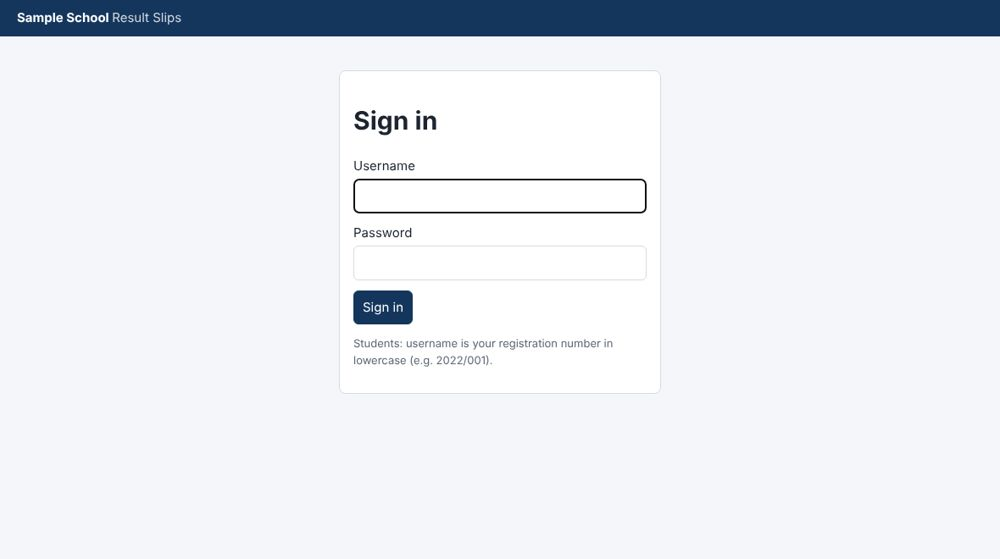
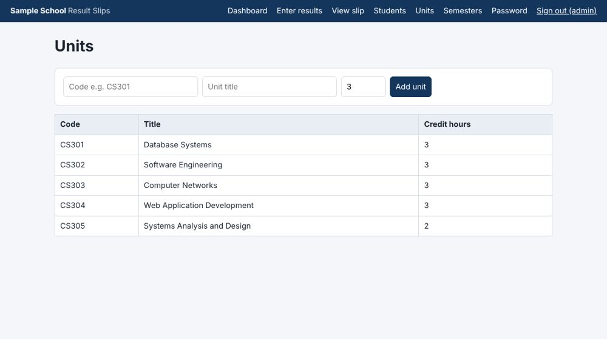
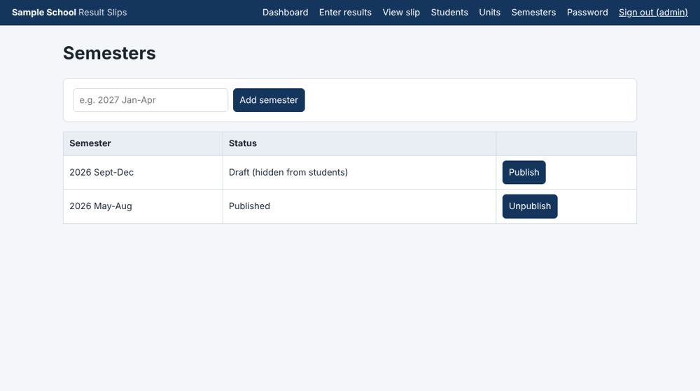
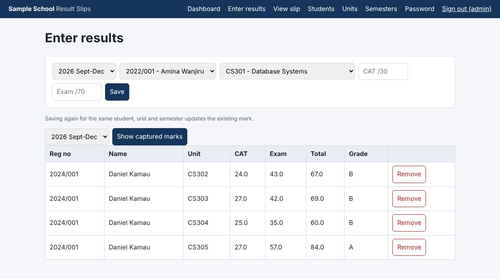
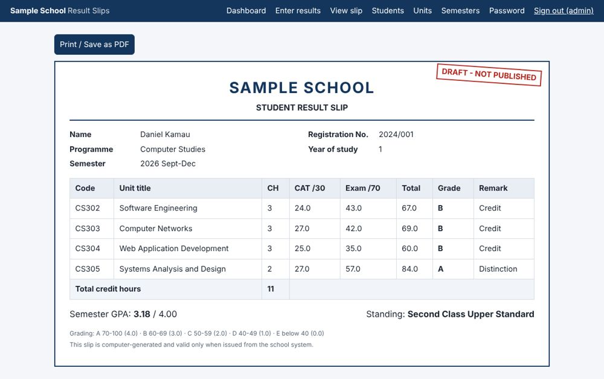
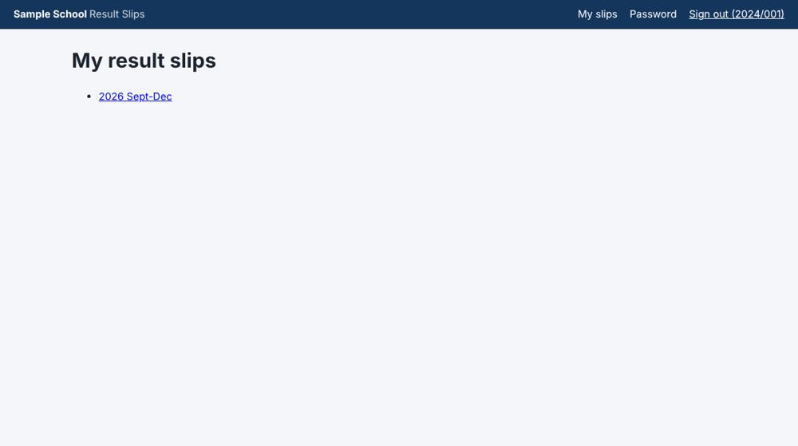

# School Management System: Student Result Slips

A role-based web app that captures student marks, computes grades and GPA automatically, and issues printable result slips. Students can view only their own slips, and only after a semester is published.

> A demo school management app focused on results. The login accounts below are demo data only.

## Features
- Three roles: **Admin**, **Lecturer**, **Student**
- Admin manages students, units and semesters, and publishes or unpublishes results
- Marks entry (CAT /30, Exam /70) with server-side validation; re-entering a mark updates it
- Automatic total, letter grade, grade points, semester GPA and academic standing
- Printable result slip (browser print / Save as PDF); unpublished semesters show a DRAFT mark
- Security: salted password hashes, CSRF protection, role checks, ownership checks, parameterised SQL

## Tech stack
Python 3, Flask, SQLite, Jinja templates, plain CSS.

## Run it
```bash
pip install -r requirements.txt
python seed.py        # creates results.db with demo data
python app.py         # open http://127.0.0.1:5000
python test_app.py    # run the automated tests
```
Optional environment variables: `SECRET_KEY` (so sessions survive restarts) and `SCHOOL_NAME` (shown on pages and slips; default "Sample School"). Example: `export SCHOOL_NAME="Greenfield Academy"` (Windows: `set SCHOOL_NAME=Greenfield Academy`).

**Demo logins (demo data only):** `admin` / `admin123`, `lecturer` / `lecturer123`, student `2022/001` / `2022/001`.

## Screenshots
| Login | Dashboard |
|---|---|
|  |  |

| Units | Semesters (draft / published) |
|---|---|
|  |  |

| Enter results | Draft slip (admin preview) |
|---|---|
|  |  |

| Student: my slips | Published slip |
|---|---|
|  |  |

| Access control: another student's slip is blocked (403) |
|---|
|  |

## Documentation
Full design (requirements, architecture, database, business rules, security, testing): [docs/DESIGN.md](docs/DESIGN.md).

## Grading scale
A 70-100 (4.0), B 60-69 (3.0), C 50-59 (2.0), D 40-49 (1.0), E below 40 (0.0). The scale and class boundaries are assumptions; change them in `grade_for()` and `classify()` in `app.py` to match your institution's rules.

## Built with AI assistance
The initial code and design document were produced with Claude (Anthropic) and then run, tested and demonstrated by the author.

## Limitations
No bulk marks import, cumulative CGPA, password reset by email, or mark-change audit history. SQLite and Flask's development server are suitable for a demo, not production.
